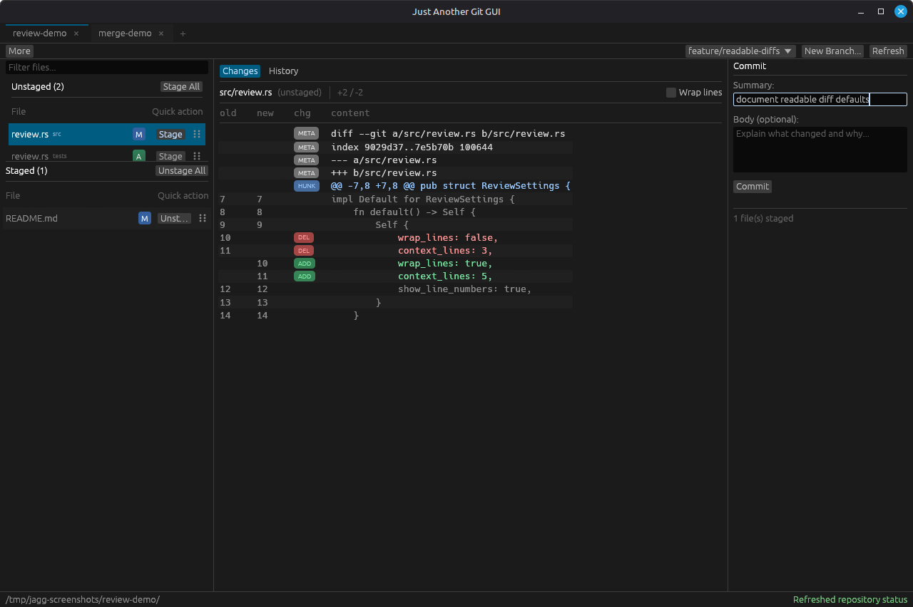
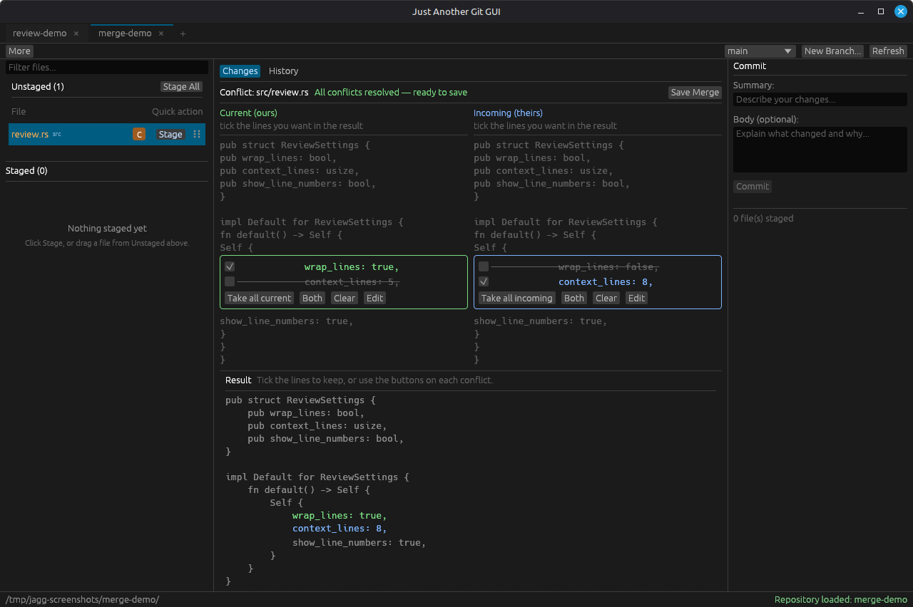

# Just Another Git GUI

**Just Another Git GUI** is a lightweight desktop Git client built in Rust with `egui`.

It focuses on the everyday local workflow first—review changes, stage files, commit, switch branches, inspect history—and adds a practical GitHub flow on top: publish an existing folder, sign in with GitHub device flow, push branches, and jump straight into the relevant pull request page.

<p align="center">
  <a href="https://github.com/neisep/justanothergitgui/releases">Download</a>
  &middot;
  <a href="https://github.com/neisep/justanothergitgui/issues">Report Bug</a>
  &middot;
  <a href="https://github.com/neisep/justanothergitgui/issues">Request Feature</a>
</p>

<p align="center">
  <a href="https://github.com/neisep/justanothergitgui/releases"></a>
  <a href="https://github.com/neisep/justanothergitgui/blob/master/LICENSE"></a>
  <a href="https://github.com/neisep/justanothergitgui/actions"></a>
</p>

---

## 📸 Screenshots





---

## Features

- Stage, unstage and review diffs, then commit with optional Conventional Commits checks
- Resolve merge conflicts line by line with a live result preview
- Switch, create, pull and push branches; browse history with a commit graph
- Clone repositories and create SemVer tags from `main` / `master`
- Publish a folder to GitHub, sign in with device flow, and open or create pull requests
- GitHub sign-in is stored in the OS keychain; no GitHub CLI needed

---

## Getting Started

Download the latest build for Linux or Windows from [Releases](https://github.com/neisep/justanothergitgui/releases), or build it yourself with Rust 1.85+:

```bash
git clone https://github.com/neisep/justanothergitgui.git
cd justanothergitgui
cargo build --release
```

The binary ends up in `target/release/`.

For GitHub repositories, use an HTTPS `origin` URL so the app can reuse your GitHub sign-in.

### Keyboard Shortcuts

| Shortcut | Action |
| --- | --- |
| Ctrl/Cmd+S | Stage / unstage the selected file |
| Ctrl/Cmd+Enter | Commit staged changes |
| Ctrl/Cmd+R or F5 | Refresh |
| Ctrl/Cmd+L | Focus the commit summary |

---

## Contributing

Contributions are welcome. Fork the repository, make your changes on a branch, run `cargo fmt --all` and `cargo test`, then open a pull request.
